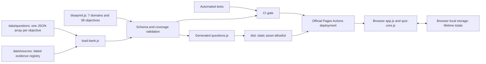

# Architecture and reference baseline

## Inspected baseline

Reference: `bajor/gcp-ml-quiz`, commit `9c38f0c026487fe29e009a5c147a2fcf3cc5f475`.
All eight application/documentation/test files and the validator were inspected.
Its clean local tree matched GitHub's main tree. Baseline checks passed: three tests
and 16 schema-valid questions. The reference repository had no Actions workflows;
GitHub reported Pages disabled at inspection. Its source, not an assumed live state,
therefore supplies the reproducible visual baseline. No reference file was modified.

The original uses a static HTML shell, CSS variables, an immediately invoked browser
script, a global question array, a browser-side schema validator, Fisher–Yates shuffling,
local-storage lifetime counters, single-question navigation, and per-option explanations.
No framework, package dependencies, backend, or runtime API is present.

## Minimal extensions

The user's explicit requirement selects reuse over a framework rewrite or backend.
`index.html`, `style.css`, and `app.js` are adapted from the reference. All original
CSS declarations are retained unchanged. Added declarations only support selected
multiple-response buttons, metadata/disclaimer/help, long identifier/source wrapping, and native
`hidden` behavior. The latter prevents the original `.explanations { display: grid }`
rule from exposing an element whose hidden attribute should suppress it.

`quiz-core.js` extracts shuffle, original-index mapping, exact-set scoring, and storage
validation so they can be tested without a browser. `app.js` remains the same small
DOM-based controller. Multiple responses use the same answer buttons with
`aria-pressed`, a count instruction, and an explicit disabled-until-valid submit button.
Single answers retain immediate scoring. Correctness is tied to original indices,
never the current displayed position. No partial credit is awarded.

Persistent totals use `claudeArchitectProfessionalQuizProgress.v1`, separate from the
reference site's storage key because both Pages sites share the same origin.
Session score and saved totals are distinct. There is no saved deck or active-answer
state. Corrupt/blocked storage falls back safely without preventing practice.

## Data and publication flow

<!-- mermaid-diagram: quiz-data-flow -->

<!-- /mermaid-diagram: quiz-data-flow -->

Authoring JSON uses `sourceIds`; `scripts/load-bank.js` expands the registry into a
visible primary source and supplementary references, adding the exam guide mapping.
`questions.js` is deterministic generated data checked into Git for direct-file use.
The browser validates the expanded bank again before binding interactions.
Source evidence and legal-retrieval caveats remain in repository data/docs, not the site.

`scripts/build.js` requires valid schema and minimum coverage, writes the bank, and
copies only `index.html`, `style.css`, `blueprint.js`, `question-schema.js`,
`quiz-core.js`, `questions.js`, and `app.js` into `dist/`, plus `.nojekyll`.
Unexpected files in `dist/` cause failure instead of accidental publication.
Every asset reference is relative, supporting the Pages repository subpath.

The deployment workflow depends on the reusable CI gate. It uploads only `dist/`
and uses `pages: write` and `id-token: write` solely in the deployment job. Research,
Git metadata, credentials, and Node tooling never enter the website artifact.
The pinned official upload action excludes dotfiles, including the local `.nojekyll`
marker. The observed Pages archive therefore contains exactly the seven runtime
assets. This custom workflow does not run Jekyll or require that marker to be served.

## Acceptance

Schema and coverage must pass; generated data must match its sources; the exact
selection set must survive answer permutations; all explanations and sources must
render; desktop/mobile browser checks must pass; the final deployed URL must be
verified separately from local success. See [verification](verification.md).

# References

1. BAJOR. [Reference quiz repository](https://github.com/bajor/gcp-ml-quiz). Inspected revision above. Accessed on: 2026-10-26 UTC.
2. [Question authoring](question-authoring.md), [official blueprint](exam-blueprint.md), and [research log](research-log.md).
3. GITHUB. [Using custom workflows with GitHub Pages](https://docs.github.com/en/pages/getting-started-with-github-pages/using-custom-workflows-with-github-pages). Accessed on: 2026-10-26 UTC.
4. GITHUB. [Pinned upload-pages-artifact action](https://github.com/actions/upload-pages-artifact/blob/7b1f4a764d45c48632c6b24a0339c27f5614fb0b/action.yml). Dotfile exclusion in the archive step. Accessed on: 2026-10-27 UTC.
